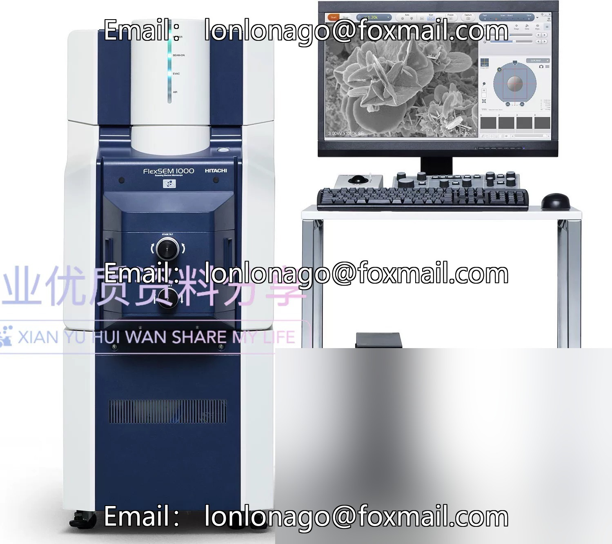
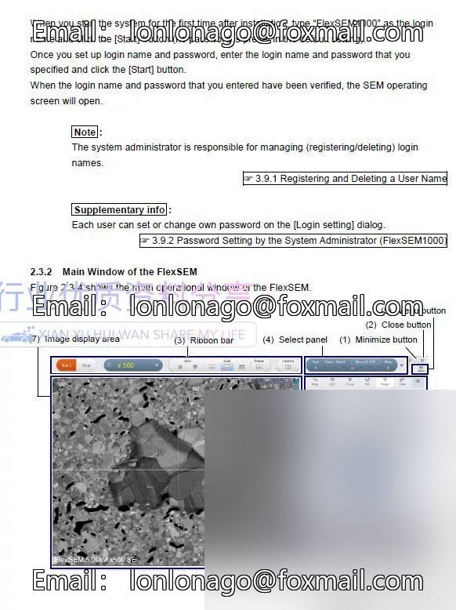
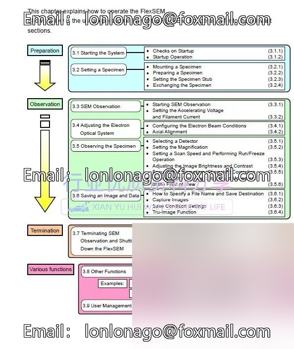
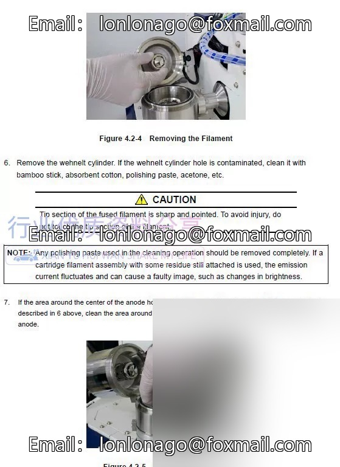
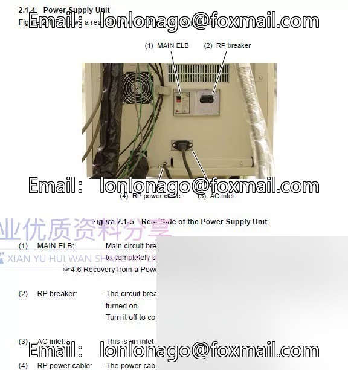
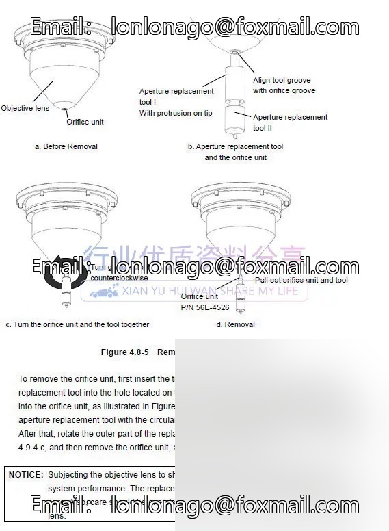

# Hitachi FlexSEM1000 SEM tungsten filament field emission scanning electron microscope

## Body

ASMN FlexSEM1000 SEM tungsten filament field emission scanning electron microscope installation manual, which includes in detail the equipment structure and detailed operation and maintenance methods, and has significant reference value.

Capture and send the electronic original directly! The following images include screenshots of the file portion. Please confirm before placing the order! Due to the replicable nature of electronic documentation Therefore, are allowed after purchase! Thanks for understanding!

For personal learning and reference use only.

The manual covers installation of the HITACHI FlexSEM1000 tungsten-filament field-emission scanning electron microscope, including equipment structure and operation and maintenance methods, along with direct electronic files and the first-time system login procedure.

<!-- AI_ENRICHED -->

## Images

## Payment

Here is a pay link on Stripe ( https://buy.stripe.com/3cs8yP7sY87d0vu9AB ). Please contact me lonlonago@foxmail.com after funding $89, and I will send you a complete data files , thank you!

